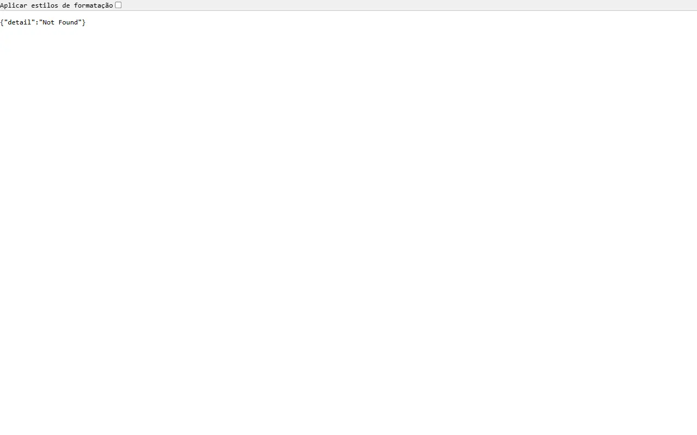

<!-- readme-padrao -->
# Atende AI

> Atende AI (atende-whats/insta/tiktok/face) e Fala Fael: atendimento com IA nas redes do cliente pelo gateway de canais, com regras (skill) do cliente, humano assume, planos Start/Pro/Top. Use para mexer no Atende AI, no Fala Fael ou na conexão de WhatsApp/Instagram dos produtos.


## O que é
Atende AI (atende-whats/insta/tiktok/face) e Fala Fael: atendimento com IA nas redes do cliente pelo gateway de canais, com regras (skill) do cliente, humano assume, planos Start/Pro/Top. Use para mexer no Atende AI, no Fala Fael ou na conexão de WhatsApp/Instagram dos produtos.

Estado: **no ar**. Produto da Rangel Tech, vendido pela Cakto (conta do Lucas). Registro único dos produtos: `vps_rt_infra/registro/produtos.yml` (spec 57).

## Onde está no ar
- https://atende-ai.rangeltech.net

Variantes que usam este mesmo código:
- **Atende AI Whats**: https://atende-whats.rangeltech.net (mesmo código, outra "pele" por endereço; vendido como produto separado)
- **Atende AI Insta**: https://atende-insta.rangeltech.net (mesmo código, outra "pele" por endereço; vendido como produto separado)
- **Atende AI Face**: https://atende-face.rangeltech.net (mesmo código, outra "pele" por endereço; vendido como produto separado)
- **Atende AI TikTok**: https://atende-tiktok.rangeltech.net (mesmo código, outra "pele" por endereço; vendido como produto separado)

**Painel do administrador:** `https://atende-ai.rangeltech.net/admin` (login único dos produtos; a credencial está no Infisical, `rt-produtos/_admin`).



O usuário de teste (QA) de cada produto é obtido no painel único (`painel.rangeltech.net`, aba do produto).

## Onde faz o deploy
Este repositório **só publica** o artefato; **quem implanta é o `vps_rt_infra`** (nenhum container é trocado à mão).

1. Publicar a release: criar a tag (`v*`); o workflow `.github/workflows/release.yml` gera a imagem e o `release-manifest.json` e publica como release.
2. Implantar (de madrugada, 00h às 06h de Brasília): `gh workflow run deploy.yml --repo RangelTech/vps_rt_infra -f service=atendeai`
   - Só validar, sem implantar: acrescentar `-f dry_run=true`.
3. Voltar uma versão (rollback): `gh workflow run deploy.yml --repo RangelTech/vps_rt_infra -f service=atendeai -f version=<tag-antiga>`.

O serviço no mapa de releases é `atendeai` (`vps_rt_infra/releases/sources.json`).

## Como funciona por dentro
- **API e site:** FastAPI (Python) em `app/`, com a landing em `static/`. Container único (`Dockerfile`).
- **Dados:** hoje SQLite no volume do container; **está planejada a migração** para o banco `produtos` do Postgres (um schema por produto) e dos arquivos para o MinIO (spec 57, seções 8 e 8.6).
- **IA:** fala com o Qwen pelo `llm-access` (chave por produto).
- **Cobrança:** webhook da Cakto (`/api/cakto` ou rota equivalente) libera o plano; a conciliação diária compara pedidos e assinaturas.
- **Login:** hoje por código no e-mail; passa para e-mail e senha com captcha invisível e "entrar por link" (spec 57, seção 5A).

## Segredos
Só os **nomes** das variáveis estão neste repositório, em [`segredos.yml`](segredos.yml). Os **valores** ficam no Infisical (projeto `rt-produtos`, ambiente `prod`, pasta `atendeai`) e chegam à VPS **gerados no momento do deploy**. Nunca coloque valor de segredo no git.

## Rodar e testar localmente
```bash
python -m venv .venv && source .venv/bin/activate   # no Windows: .venv\Scripts\activate
pip install -r requirements.txt
pytest
```
Os testes de QA em produção são por cliques reais (relatório em PDF no `new_ragente/qa/evidencias`).

## Links
- Painel único: https://painel.rangeltech.net (aba do produto: links, usuário de QA, planos)
- Spec de organização geral: `new_ragente/specs/57_ORGANIZACAO_GERAL_PRODUTOS_E_PAINEL.md`
- Monitor: Uptime Kuma, `atendeai`

## Notas técnicas (README anterior)

# Atende AI (Whats, Insta, TikTok, Face)

Atendimento com IA nas redes do cliente. Um código, quatro marcas (a marca vem do host):
`atende-whats`, `atende-insta`, `atende-tiktok`, `atende-face` (`.rangeltech.net`).

- **Conexão 24/7:** pelo gateway de canais do LUAR (`chatwoot-bridge`, `/internal/channels`), que mantém a sessão
  (Matrix + pontes mautrix; TikTok por worker) e entrega as mensagens num webhook assinado (HMAC, janela de 5 min).
  `account_id` no gateway = `ATENDEAI_CONTA_BASE` (7.000.000) + id do usuário, para nunca colidir com conta do Chatwoot.
- **Harness** (`app/atendente.py`): humano assumiu > palavra que chama humano > fora do horário > IA com as regras;
  sem regra ou sem resposta, passa para humano. Nunca inventa preço/prazo.
- **Regras (skill):** construtor por conversa (8 assuntos), edição à mão, versões, "Testar" sem enviar nada.
- **Painel:** conversas (assumir/devolver, responder como você), conta conectada (QR, código de pareamento, senha/2FA),
  plano. Login com senha (padrão), código por e-mail ou "esqueci a senha" (módulo comum).
- **Planos** por marca, pela Cakto: Start/Pro/Top = contas conectadas e respostas da IA por mês.

## Rodar os testes
```
pip install -r requirements-dev.txt && python -m pytest -q
```

## Variáveis
`ATENDEAI_LLM_KEY`, `ATENDEAI_SEGREDO_SESSAO`, `ATENDEAI_CANAIS_TOKEN` (= `CHANNELS_GATEWAY_TOKEN` do gateway),
`ATENDEAI_CANAIS_URL` (padrão `http://chatwoot-bridge:8100`), `ATENDEAI_WEBHOOK_BASE` (padrão `http://atendeai:8000`),
`ATENDEAI_CAKTO_SEGREDO`, `ATENDEAI_CHECKOUTS`, `ATENDEAI_PLANOS_CAKTO`, `ATENDEAI_ADMIN_KEY`, `ATENDEAI_DEMO_EMAIL`, SMTP_*.

Deploy: release neste repo (workflow `Release`), implantação só pelo `vps_rt_infra`.
